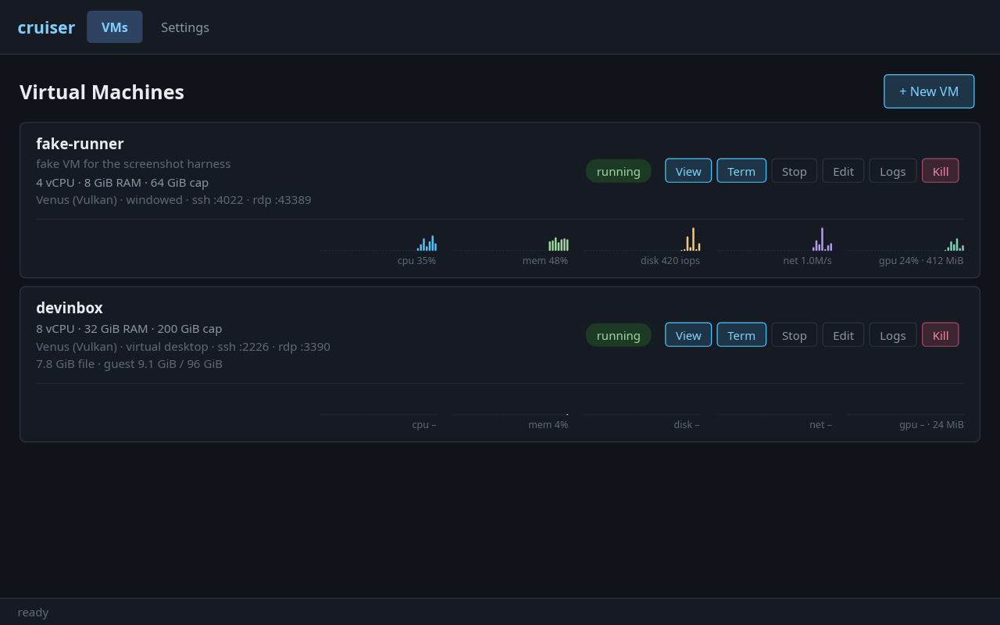
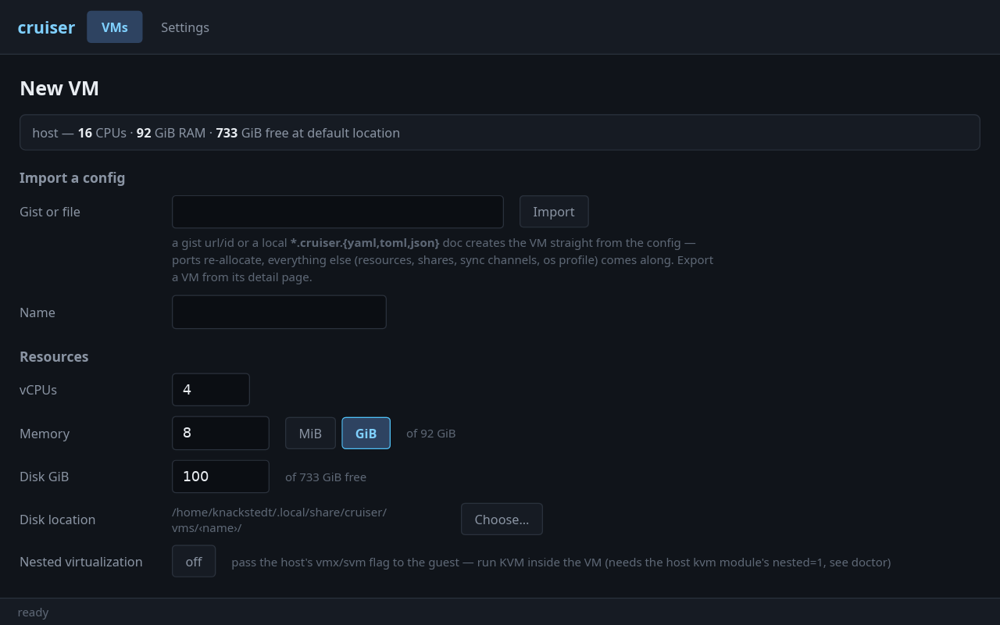
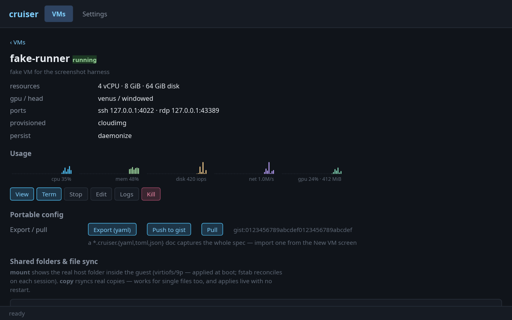
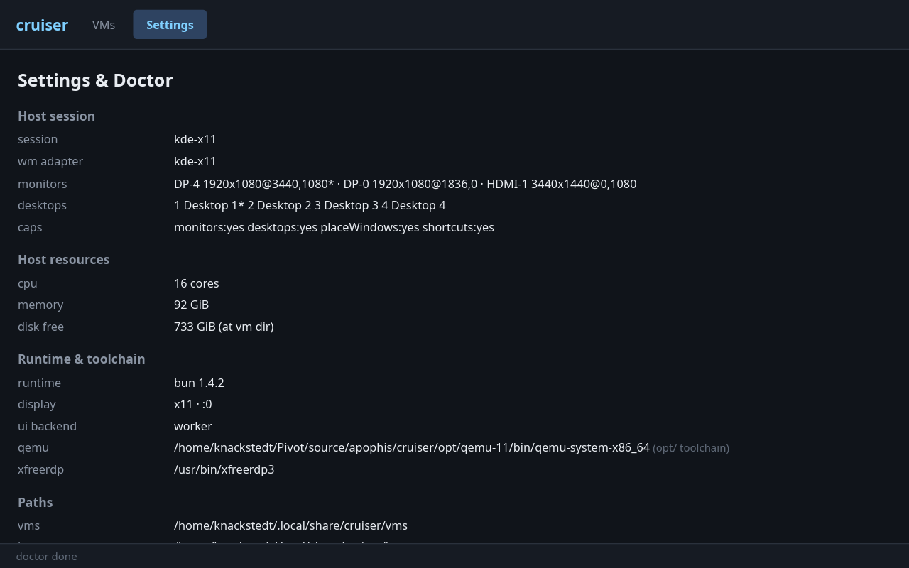
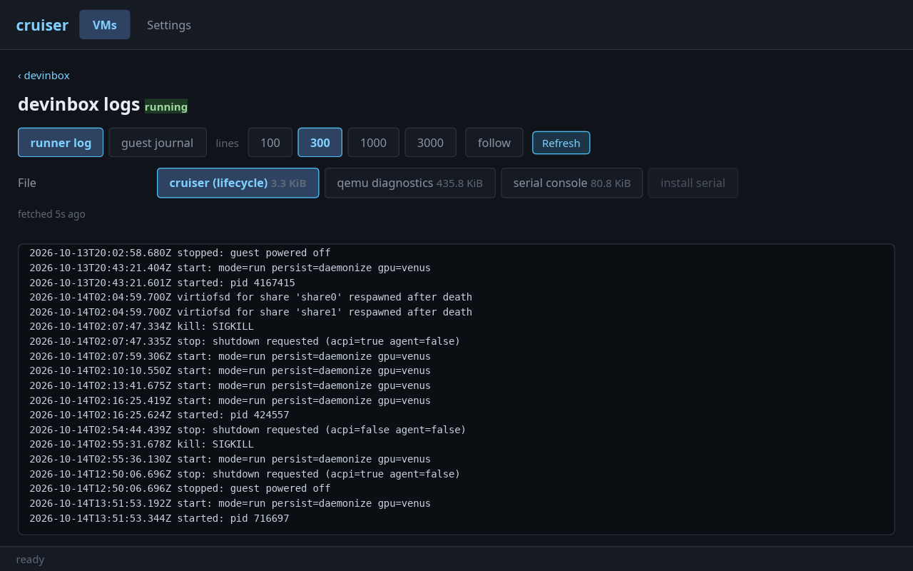
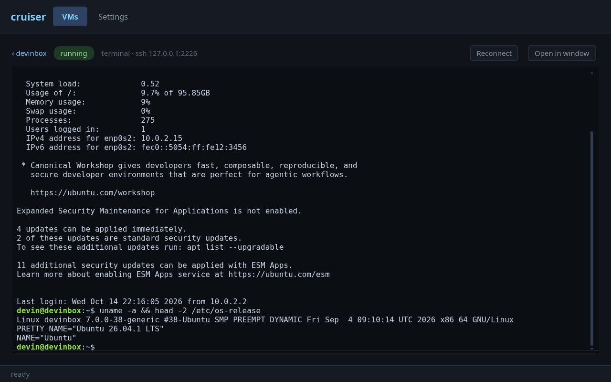

# cruiser

Linux VMs that live on your Linux desktop — no dual boot, no container
indirection, no Electron. Cruiser drives QEMU/KVM directly and gives each
guest its own window (or a whole virtual desktop), with your clipboard,
theme, folders and credentials following along.

Think *WinBoat, but the guest is Linux too*: raw QEMU + QMP/QGA on the
backend, a native winit + wgpu UI on the front.



## What you get

- **Unattended installs** — pick Ubuntu, Debian or Fedora, a desktop
  (GNOME/KDE) and a browser; cruiser downloads a cloud image, seeds it
  with NoCloud, and does the whole setup itself — user, autologin, guest
  tools, share mounts, monitor layout. There is no installer to click
  through. (ISO autoinstall is there too if you want the real thing.)
- **A guest that feels native** — windowed, fullscreen-per-monitor,
  whole-virtual-desktop, or per-app (waypipe) head modes. The dmabuf
  viewer renders the guest straight off the GPU; multi-monitor guests
  mirror your real monitor layout.
- **Desktop glue, synced live** — text clipboard both ways, dark/light
  theme, accent color, contrast, timezone, locale, keymap, scale/DPI and
  wallpaper follow the host while a viewer is attached.
- **Folders & file sync** — share a host dir into the guest over virtiofs
  (rw or read-only) and the guest's fstab stays reconciled — or use
  copy-mode shares that rsync both ways while you work.
- **Credential sync (opt-in)** — git name/email, your git SSH key,
  ssh-agent forwarding, host proxy settings and custom CA roots. All five
  are off by default: `vm sync <vm> <channel> on`, or the create-form
  checkboxes.
- **Shareable VMs over gist** — `vm gist push` publishes a sanitized
  `*.cruiser.yaml` to a GitHub gist; `vm import <gist-url|id>` rebuilds
  the VM from it (ports re-allocate automatically). One link turns into a
  fully-provisioned dev box, unattended, and `vm config pull` re-syncs
  from the source later.
- **Snapshots, disks, USB** — live snapshots/restore, qcow2 backup/resize,
  USB enumerate + hotplug passthrough.
- **Everything reachable** — embedded guest terminal (xterm.js over ssh),
  guest journalctl, serial/qemu/runner log viewers, and a full CLI that is
  the same binary as the app.











### A safe room for AI coding agents

A real VM is a convenient place to let an AI assistant run wild: give it
the project through a shared folder, open the embedded terminal (or
`vm ssh`), and let it work completely unattended — no approval prompts,
no worrying that a bad command takes your host down with it. If it ever
does make a mess, `vm snapshot` / `vm restore` is right there.

## Getting started

Grab the `.deb` or AppImage from Releases — the package ships its own
pinned QEMU 11 toolchain, so there is almost nothing to install. The same
binary is both the app and the CLI: `cruiser doctor` reports whatever
else your host might want.

From source:

```sh
bun install
bun run cli -- doctor                    # what's missing on this host
bun run cli -- vm create myvm --cpus 8 --mem 16384 --disk 120
bun run cli -- provision cloudimg myvm 26.04 --user me --password secret
bun run cli -- vm start myvm             # boots and opens the viewer
bun run src/native-entry.ts              # the UI
```

Host extras (all optional, `doctor` tells you which matter):
`apt install freerdp3-x11 ovmf cloud-image-utils waypipe socat wmctrl
xdotool qdbus` (+ `virtiofsd` for the preferred share backend).

Docs: the `docs/` Starlight site (`cd docs && bun run dev` to preview).
Contributor internals: `AGENTS.md`.
